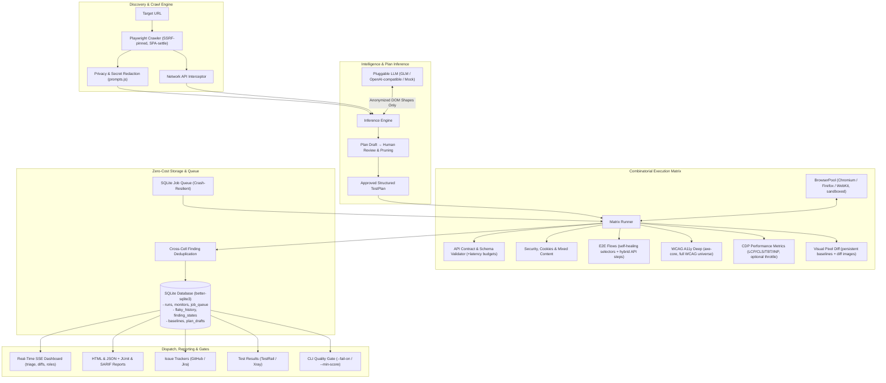

# Testigator

[](https://github.com/saqi-saqi/Testigator)
[](https://www.npmjs.com/package/testigator)
[](LICENSE)
[](package.json)
[](https://github.com/saqi-saqi/Testigator/actions/workflows/benchmark.yml)

> **Official Testigator (`saqi-saqi/Testigator` · npm `testigator` · MCP `testigator-mcp` · Apache-2.0; formerly *QualityPilot*)** — Self-hosted, deterministic-first web & API QA quality-gate agent in Node.js + Playwright with local SQLite TestOps state. Rebranded to `Testigator` to avoid collisions with unrelated projects using the *QualityPilot* name; legacy `qualitypilot` CLI commands and `qualitypilot.sqlite` databases remain backward-compatible. See [Rebrand & Orientation](#namesake--directory-orientation).

> Autonomous software QA agent for web applications and APIs — crawls, infers test plans (with human approval), executes matrix test suites across browsers, viewports, and authenticated roles, files deduplicated regressions to your issue tracker, and gates your CI pipeline.

Testigator is a zero-cost, self-hostable QA testing platform built on Node.js and Playwright. Give it any target web URL and Testigator will autonomously crawl pages, inspect network waterfalls with automatic privacy redaction, generate test suites via an AI planner (or deterministic heuristics), and run combinatorial tests across browsers, responsive viewports, and authenticated sessions. All runs, monitors, job queues, flaky history, visual baselines, and finding triage state are persisted locally in SQLite with zero cloud dependencies.

---

## ⚡ 2-Minute Quickstart

### Prerequisites
- Node.js >= 22.19.0 (the version `package.json` `engines` enforces)
- npm >= 9.0.0

### 1. Install

**From npm (recommended):**

```bash
npm install -g testigator
npx playwright install chromium   # one-time browser download (~130 MB)
```

This installs the `testigator` CLI and `testigator-mcp` MCP server (legacy `qualitypilot` / `qualitypilot-mcp` aliases remain included for existing setups).

**From source (development):**

```bash
git clone https://github.com/saqi-saqi/Testigator.git
cd Testigator
npm install
npx playwright install --with-deps chromium
```

This gives you the same commands locally through the repository scripts:
`npm run check -- <url> …` (CI gate CLI) and `npm run mcp` (MCP server).

### First scan (CLI, no dashboard needed)

```bash
testigator check https://example.com --max-pages 3
```

Prints a score and a findings summary, and exits 0 when the quality gate
passes (exit 1 = gate failed, 64 = usage error, 70 = scan failure). To scan a
local dev server, pass `--allow-private` (or set `SQA_ALLOW_PRIVATE=true` in
the environment) — the SSRF boundary is ON by default.

### 2. Start the Server & Dashboard
```bash
npm run start:dashboard
```
Open **[http://localhost:8080](http://localhost:8080)** in your browser.

> **Security defaults**: the dashboard binds to `127.0.0.1` only (override with `SQA_BIND`), ships with helmet security headers and API rate limiting, and **refuses to start without an API token when `NODE_ENV=production`**.

### 3. Run Your First Scan
Trigger a headless scan against any public site directly from your terminal:
```bash
# Using curl
curl -X POST http://localhost:8080/api/runs \
  -H "Content-Type: application/json" \
  -d '{
    "url": "https://example.com",
    "options": {
      "maxPages": 3,
      "browsers": ["chromium"],
      "concurrency": 2
    }
  }'
```
Or open the dashboard UI at `http://localhost:8080`, type `https://example.com`, and click **Start Test** — or click **🧭 Review plan** first to inspect, prune, and approve the AI-generated test plan before anything runs.

*(To test local dev sites on `localhost`, set `SQA_ALLOW_PRIVATE=true` in `.env`)*

## 🧠 Test Planning: Deterministic by Default, Local Model Optional

Plan inference is the only place Testigator uses a model. Crawling, the execution matrix, axe accessibility, security headers, API contracts, performance metrics, visual diffing, scoring and the quality gate are deterministic — they run with **no API key and no token cost**.

With no LLM configured the planner falls back to heuristics (the `mock` provider). One warning line is expected; set `SQA_LLM_PROVIDER=mock` to silence it. This is the default CI mode, not a degraded one: nothing in the gate or the deterministic executors depends on a model.

When you do want AI planning, pick a preset. All five speak the same OpenAI-compatible `/chat/completions` dialect — no vendor SDK, no cloud requirement:

| Preset | Endpoint | Key | Model |
| :--- | :--- | :--- | :--- |
| `ollama` | `http://127.0.0.1:11434/v1` (`OLLAMA_BASE_URL`) | not needed (`OLLAMA_API_KEY` optional) | `qwen2.5:7b` — override with `OPENAI_MODEL` |
| `vllm` | `http://127.0.0.1:8000/v1` (`VLLM_BASE_URL`) | `VLLM_API_KEY` if started with `--api-key` | **required**: `OPENAI_MODEL` |
| `openrouter` | `https://openrouter.ai/api/v1` | `OPENROUTER_API_KEY` | `openai/gpt-4o-mini` |
| `openai` | `https://api.openai.com/v1` (`OPENAI_BASE_URL`) | `OPENAI_API_KEY` | `gpt-4o-mini` |
| `byo` | **required**: `OPENAI_BASE_URL` | `OPENAI_API_KEY` if your gateway needs one | `OPENAI_MODEL` |

```bash
# Fully local: no cloud key anywhere in the run
ollama pull qwen2.5:7b
OLLAMA_CONTEXT_LENGTH=8192 testigator check http://localhost:3000 \
  --allow-private --llm-preset ollama
```

Presets are also selectable through `SQA_LLM_PRESET=ollama` instead of the flag; `SQA_LLM_PROVIDER` accepts the same names for backwards compatibility.

> **Ollama context window.** Ollama serves a small `num_ctx` by default (4096 tokens on recent versions, less on older ones) and drops older prompt tokens once it overflows. Raise it with `OLLAMA_CONTEXT_LENGTH=8192` (Ollama ≥ 0.6) or `num_ctx` in a Modelfile before trusting plan quality. Testigator prints this warning whenever the `ollama` preset is active; `SQA_LLM_NO_WARN=1` silences it.

### Optional: FreeLLMAPI (community, hobby use)

FreeLLMAPI's own README describes it as for “personal experimentation only” and “local-first and single-user by design”. It is a convenient hobby gateway, but it is not the recommended path for a privacy-sensitive QA scan — prefer the `ollama`, `vllm` or `byo` presets above when the target is anything you care about.

If you still want to use it, Testigator can talk to a local [FreeLLMAPI](https://github.com/tashfeenahmed/freellmapi)
gateway through its OpenAI-compatible endpoint:

```dotenv
SQA_LLM_PROVIDER=openai
OPENAI_BASE_URL=http://localhost:3001/v1
OPENAI_API_KEY=sk-your-openai-compatible-key
OPENAI_MODEL=auto
```

Keep the key in `.env` or your user-level environment; do not commit it or
place it in VS Code workspace settings. For VS Code coding assistance, install
an OpenAI-compatible extension such as Continue, Cline, or Roo Code and use:

- Base URL: `http://localhost:3001/v1`
- API key: your FreeLLMAPI unified key
- Model: `auto` (or a model shown by FreeLLMAPI's `/v1/models` endpoint)

The built-in GitHub Copilot service cannot be redirected to a custom endpoint;
these extensions are separate clients. Keep FreeLLMAPI bound to localhost and
do not expose port `3001` publicly.

---

## 🤖 Use Testigator from Claude Code / Cursor

Testigator exposes an official [Model Context Protocol (MCP)](https://modelcontextprotocol.io/) server running over standard input/output (`stdio`). This allows AI coding agents (Claude Code, Cursor, Codex, or any MCP-compatible client) to call Testigator's accessibility, API contract, console error, and security checks directly inside their edit-test-fix loop.

### 1. Register the MCP Server

Add this configuration snippet to your `.mcp.json` (Claude Code) or Cursor MCP settings (`~/.cursor/mcp.json` or `.cursor/mcp.json`):

```json
{
  "mcpServers": {
    "testigator": {
      "command": "testigator-mcp",
      "env": {
        "SQA_ALLOW_PRIVATE": "true"
      }
    }
  }
}
```

Running from a source checkout instead of a global install? Use
`"command": "node"` with `"args": ["src/mcp/stdio.js"]` and set the working
directory to the repo root.

> **Why `SQA_ALLOW_PRIVATE=true`?**
> Testigator's enterprise SSRF boundary blocks private IP ranges (`127.0.0.1`, `10.0.0.0/8`, `192.168.0.0/16`, CGNAT, IPv4-mapped IPv6 in any spelling, cloud metadata endpoints) by default — for the MCP server, the dashboard and the `testigator check` CLI alike. Setting `SQA_ALLOW_PRIVATE="true"` (or passing `--allow-private` to `check`) permits local loopback scanning so your agent can verify `http://localhost:3000` or local dev servers.

> **Probe redirect policy (audit L-3):** every HTTP probe the scanner issues — security-header audit, authz reachability, injection differentials, API fuzz, link checks — goes through `ssrf.safeFetch`: the initial URL **and every redirect `Location`** are DNS-resolved and range-checked *before* Testigator connects to them. A redirect to a private/loopback/cloud-metadata address, a non-http(s) scheme, or an unparseable `Location` fails that probe closed (logged as an event, never reported as a target defect). Redirect chains are bounded; loops abort with `Too many redirects`.

> **Security Note**: The `stdio` transport runs as a local subprocess with zero network exposure. If an HTTP/SSE transport is enabled for remote access in the future, token authentication becomes mandatory.

### Zero-config demo (no LLM key required)

Testigator runs without any AI credentials: plan inference falls back to
deterministic heuristics (the `mock` provider). One warning line is expected:

```
[llmProvider] No LLM provider configured ... using MockProvider
```

Set `SQA_LLM_PROVIDER=mock` to silence it. To enable AI planning, pick a preset
with `--llm-preset ollama|vllm|openrouter|openai|byo` (see *Test Planning* above).
The `z-ai-web-dev-sdk` vendor SDK ships as
an **optional dependency** - it is only loaded when you explicitly select
`SQA_LLM_PROVIDER=glm`, so its absence never breaks installation or the other
providers.

### 2. Available MCP Tools

| Tool | Purpose | Latency |
| :--- | :--- | :--- |
| `quick_check(url, scope?)` | Fast check (axe a11y + API contract + console/network errors) on a single page | ~5–15s |
| `check_accessibility(url)` | Focused WCAG a11y audit (axe-core) for markup & styling changes | ~1–3s |
| `check_api_contract(url, endpoints?)` | Probes REST endpoints for unexpected status codes or broken response schemas | ~100ms–2s |
| `explain_finding(rule_id)` | Plain-language explanation + recommended fix for any rule ID (e.g. `image-alt`) | Immediate |
| `start_full_scan(url, options?)` | Asynchronous deep matrix scan (crawls, multi-browser, viewports). Returns `job_id` | Immediate |
| `get_scan_status(job_id)` | Polls status (`pending` | `running` | `complete` | `failed`) and pages scanned | Immediate |
| `get_scan_report(job_id, verbosity?)` | Invariant-validated structured JSON report with CONFIRMED findings | Immediate |

> **Compact MCP payloads:** `quick_check`, `check_accessibility`, `check_api_contract`, and `get_scan_report` return compact summaries (measured max response **~1,366 tokens / 5,464 bytes**, staying well under the 2,000-token budget) and write complete redacted JSON artifacts to `.testigator/artifacts/<runId>/report.json` ([audit receipt](benchmark/receipts/2026-11-25-mcp-payload-audit.md)).

### 3. Example Prompts for Your Coding Agent

Once connected, you can give your AI agent natural prompts like:

- **Pre-commit verification**:
  > *"Run a quick check against http://localhost:3000 before I commit this change."*
- **A11y regression check**:
  > *"I just refactored the checkout modal and form inputs. Run check_accessibility against http://localhost:3000/checkout and fix any violations."*
- **Investigate & repair**:
  > *"The quick check failed on rule `api-status-mismatch`. Call explain_finding to understand the requirement, find the route handler, and fix the mismatch."*
- **Deep matrix scan**:
  > *"Start a full scan on http://localhost:3000 with start_full_scan, poll get_scan_status until done, and summarize confirmed bugs."*

---

## 🐳 Self-Host with Docker (1 Command)

Testigator runs on 100% free, official Docker base images with zero external services:

```bash
cp .env.example .env
docker compose up -d --build
```
Your dashboard is live on `http://127.0.0.1:8080` (the compose file publishes the port to loopback only), running as a non-root user, with the SQLite database and screenshots persisted to `./data`.

---

## 🏛 Architecture



### Module Breakdown
- **`src/matrix/`** & **`src/matrix/sharding.js`**: Combinatorial execution engine testing $\text{Browsers} \times \text{Viewports} \times \text{Auth Roles}$ plus CI shard partitioning (`--shard i/N`) and deterministic cross-shard report unification (`src/cli/mergeReports.js`). Deduplicates findings by `(ruleId, pageUrl, element)` and tracks flaky tests (grouped by normalized options, ≥3 alternations required).
- **`src/storage/`**: Relational persistence via `better-sqlite3` with `PRAGMA user_version` migrations — `runs`, `monitors`, `job_queue`, `flaky_history`, `finding_states`, `baselines`, `plan_drafts` — designed for future zero-friction migration to PostgreSQL.
- **`src/storage/jobQueue.js`**: Atomic SQLite-backed job queue. Guarantees in-flight and queued runs survive process crashes and restarts without Redis or BullMQ; interrupted runs are recovered and marked failed on boot, and SIGTERM/SIGINT drain cleanly.
- **`src/explorer/`**: AI test planner. Generates E2E user flows (with self-healing-selector-aware inference and `needsReview` flags for hallucinated selectors) and API schema expectations using anonymized DOM structure. Flags flows for review when selectors were never observed in the crawl.
- **`src/executors/selectorResolver.js`**: Deterministic selector self-healing ladder (original → `data-testid`/`data-test`/`aria-label` → role → text). Heals rotting selectors instead of failing noisily.
- **`src/services/testData.js`**: Test-data store (`data/testdata.json` + `SQA_TD_*` env vars) with `${VAR}` substitution in flow steps — no invented credentials.
- **`src/services/ssrf.js`**: Enterprise SSRF protection. Blocks IPv4/IPv6 private subnets, CGNAT, link-local, unique-local, 6to4/NAT64; validates **every** plan URL (flows, navigate steps, API endpoints) before any browser launches, and pins validated IPs via Chromium `--host-resolver-rules` to defeat DNS rebinding.
- **`src/services/sessionStore.js`**: Encrypted "record-once login" store using AES-256-GCM with a per-install random salt. Supports multiple named roles per monitor (e.g. `admin`, `customer`) without saving user credentials in plain text.
- **`src/services/compliance.js`**: Maps axe-core accessibility audit rules to WCAG 2.x A/AA criteria over the **full WCAG-tagged axe rule universe**, marks partial coverage honestly, and exports VPAT-style evidence reports.
- **`src/services/runDiff.js`**: Run-to-run comparison — new / resolved / persistent findings and score delta.
- **`src/reporting/`**: JUnit XML, SARIF 2.1.0, standalone HTML (`report --html`) and markdown serializers for CI pipelines, PR comments and tickets.
- **`src/executors/injection.js` + `authz.js`**: differential SQL-injection detection (status/length/error-signature signals vs a healthy baseline), login-form auth-bypass probing, DOM-XSS sink detection, and anonymous-reachability checks for admin-namespaced APIs.
- **`src/services/waivers.js`**: findings waivers with expiry and mandatory written reasons — waived findings stay visible but stop failing the gate; expired waivers warn loudly and surface the finding again.
- **`src/services/openapiImport.js`**: deterministic OpenAPI/Swagger import (`--openapi`) — the spec's paths become the API surface, no inference involved.
- **`src/cli/check.js`**, **`src/cli/testigator.js`**, & **`src/cli/mergeReports.js`**: CI quality gate (`testigator`, plus legacy `src/cli/qualitypilot.js` alias) — exit codes driven by severity thresholds and minimum score, regression-only gating via `--baseline`, waivers via `--ignore-file`, parallel matrix cells via `--concurrency`, CI sharding via `--shard <i/N>` + `--shard-out` with `testigator merge-reports`, plus `--junit`/`--sarif`/`--format markdown` export.
- **`benchmark/`** & **`benchmark/qa-bench/`**: Recall harnesses, ground truths, receipts, and the version-locked multi-role seeded web-app fixture (`NovaOps QA-Bench v1.0.0`).

---

## 🔁 Continuous Monitoring & Triage

- **Monitors** re-scan targets on a schedule with duplicate-trigger protection, catch-up after downtime, and per-monitor settings.
- **Record-once logins** capture a session (2FA/CAPTCHA included — you log in yourself) encrypted at rest; record **multiple roles** per monitor and the matrix replays each role.
- **Finding triage**: mark findings `acknowledged` / `false positive` / `fixed` in the dashboard — state persists across runs.
- **Run diff**: "Compare with previous run" shows exactly what's new, resolved, and persistent, with a score delta.
- **Visual Baseline Review (`#/baselines`)**: Side-by-side baseline / current / diff viewer in the dashboard with editable CSS `maskSelectors`, persistent `approve` and expiring `waive` decisions stored in SQLite (`baselines` + `baseline_decisions`), and next-run gate synchronization.
- **Flaky tracking**: results feed a flaky-history table (grouped by options hash; labeled flaky only after ≥3 alternations).
- **Retention**: old runs and screenshots are cleaned up automatically (checked at boot and every 6 hours).

## 🚦 CI Quality Gates

Fail builds on quality regressions straight from the CLI:

```bash
# Installed package:
testigator check https://staging.example.com \
  --max-pages 10 \
  --fail-on critical,high \
  --min-score 80 \
  --junit test-results.xml \
  --sarif testigator.sarif

# From a source checkout:
npm run check -- https://staging.example.com --max-pages 10 --fail-on critical,high --min-score 80
```
- `--fail-on critical,high` → exit 1 when any **confirmed** finding at those severities exists (single value = threshold semantics).
- `--min-score 80` → exit 1 when the quality score drops below 80.
- JUnit XML and SARIF 2.1.0 output plug into GitHub Actions, GitLab, Azure DevOps, and code-scanning UIs.

### Regression-only gating (`--baseline`)

On a second and every later scan, fail the build only on **new** findings — pre-existing issues stop blocking every PR:

```bash
# First run — the JSON report becomes the baseline (stdout is pure JSON; progress goes to stderr):
testigator check https://staging.example.com --format json > baseline.json

# Every later run — exit 1 only when a NEW finding appears:
testigator check https://staging.example.com --baseline baseline.json --fail-on low
```

- `--baseline <file|runId>` accepts a saved `--format json` report or a stored run id; an unreadable baseline is a usage error (exit 64), never a silent pass.
- `--fail-on` then applies to **new** findings only; `--min-score` stays an absolute check on the current run's score.
- The JSON output gains a `baseline` block (`newFindings`, `resolvedFindings`, `persistentCount`, `scoreDelta`).

### Access control + spec-driven scanning

- **`authz` executor** — captured GET endpoints under an `/admin` namespace are re-requested anonymously; a 2xx answer is `authz-missing` (admin APIs must require an authenticated privileged session). Response bodies are deliberately not recorded (admin payloads may contain secrets). Non-admin endpoints (e.g. a `whoami` that returns an empty user anonymously) are correctly ignored.
- **`--openapi <spec.yml|json>`** — replaces the inferred API surface with the spec's, deterministically: every path × method becomes an endpoint, query params and JSON bodies are materialized from the schema (examples > defaults > type dummies), and a relative `servers[0].url` resolves same-origin onto the target. Unreadable specs are usage errors (exit 64).
- **`--login <recording>`** — replays a recorded login session (recorded via the dashboard) against the target: the crawl and browser cells run authenticated, and the API contract probes carry the session cookie. Sessions live encrypted in `data/sessions/`. If the named recording does not exist the run fails (exit 70) — it never silently falls back to an anonymous scan.

```bash
testigator check http://localhost:3000 --openapi swagger.yml --login testigator-cli
```
### Injection probing

A dedicated `injection` executor runs three bounded, non-destructive probes and classifies results by **response differentials** (status class, length, and SQL error-signature matching), not by payload presence:

- **GET query-param differential** — mutating a captured query param (e.g. a search `q`) that turns a healthy 200 into a 500 with a SQL error signature (`SQLITE_ERROR`, MySQL/PostgreSQL/Oracle/MSSQL/Sequelize patterns) → `injection-sqli-error`.
- **Login-form auth bypass** — submits login-class forms twice (benign values, then a tautology email) and compares the login XHR status: 401 → 200 is an authentication bypass → `injection-sqli` (high). The mutated response body is never captured (it contains credentials). Account-creation pages are excluded — probes must not create data.
- **Search-route DOM sink** — loads the SPA search route with an executable-markup payload and checks whether the raw payload became LIVE DOM (not escaped text) → `injection-xss-dom`.

Safety model: probes run **by default on loopback targets only** (`localhost`, `127.0.0.0/8`, `::1`). Non-loopback targets require the explicit flag:

```bash
testigator check https://staging.example.com --authorized-target
# plan replay (and the GitHub Action's `authorized_target` input) accepts the same flag:
testigator replay plan.json --url https://staging.example.com --authorized-target
```

No `DROP`/stacked payloads exist; login sessions created by a probe die with the scan's browser context. On clean apps the probes stay silent (verified: authorized scan of the RealWorld Conduit demo → 0 injection findings).
### Speed (`--concurrency`)

Matrix cells run in parallel — browser cells share one browser process through the pool, no-browser cells (security, API contract, links/console/network) fully parallelize:

```bash
testigator check https://staging.example.com --concurrency 4   # 1–4, default 2
```

Form fuzzing loads each page **once per target** (safe mode never submits, so there is no server traffic to pace) and re-navigates only after a thrown input, instead of re-navigating for every single input. Fuzz payload generators are non-destructive too — tautologies, clause closers and boundary values, no `DROP`, no stacked statements, and safe mode never submits the form.
### CI Matrix Sharding (`--shard` & `merge-reports`)

Split large multi-viewport or multi-role matrix scans across parallel GitHub Actions runners using `--shard <i>/<N>` + isolated shard storage, then merge the shard JSON files into one unified findings set, quality score, and CI gate exit code:

```yaml
jobs:
  qa-shard:
    strategy:
      fail-fast: false
      matrix:
        shard: ['1/4', '2/4', '3/4', '4/4']
    runs-on: ubuntu-latest
    steps:
      - uses: actions/checkout@v4
      - run: npm ci && npx playwright install chromium
      - name: Run shard ${{ matrix.shard }}
        continue-on-error: true
        run: |
          node src/cli/testigator.js check https://staging.example.com \
            --shard "${{ matrix.shard }}" \
            --shard-out "shard-${{ strategy.job-index }}.json" \
            --fail-on none \
            --format json > /dev/null
      - uses: actions/upload-artifact@v4
        with:
          name: qp-shard-${{ strategy.job-index }}
          path: shard-*.json

  qa-merge:
    needs: qa-shard
    runs-on: ubuntu-latest
    steps:
      - uses: actions/checkout@v4
      - run: npm ci
      - uses: actions/download-artifact@v4
        with:
          pattern: qp-shard-*
          merge-multiple: true
      - name: Merge shards & evaluate CI gate
        run: |
          node src/cli/testigator.js merge-reports shard-*.json \
            --fail-on critical,high \
            --min-score 80 \
            --sarif testigator.sarif \
            --junit test-results.xml
```

### Job-summary markdown

`--format markdown` renders a compact gate summary (verdict, severity counts, top rules, new-vs-baseline diff) for `$GITHUB_STEP_SUMMARY`, PR comments, or tickets:

```bash
testigator check https://staging.example.com --baseline baseline.json --format markdown >> "$GITHUB_STEP_SUMMARY"
```

## 📄 Shareable Reports & Waivers

Turn a saved run into a self-contained HTML report (inline CSS, no scripts, no external assets — paste it into a ticket or attach it to a release):

```bash
testigator report baseline.json --html report.html
```

Waivers let teams accept known findings without losing them: waived findings stay visible (annotated) but stop failing the gate. A waiver without a written reason is rejected; expired waivers warn loudly and surface the finding again:

```json
{ "waivers": [ { "ruleId": "header-strict-transport-security", "pageUrl": "http://localhost:3000",
    "reason": "localhost-only target, no TLS termination", "expiresAt": "2027-06-30" } ] }
```

```bash
testigator check https://staging.example.com --baseline baseline.json --ignore-file .testigatorignore.json
```

A waiver matches on `ruleId` plus optional scope keys — `pageUrl` (origin + path; a trailing `*` is a path-prefix that never crosses the origin), `method`, `selector`, and `role`/`roles` (the scan context). Two hard rules:

- **Unknown keys are rejected.** A typo like `"rolez"` used to be dropped silently, turning a scoped waiver into a global one.
- **A role-scoped waiver only suppresses a finding observed in every role it covers.** Waiving a defect for the `admin` role never hides the same defect seen by the `anon` control scan.

URL matching is normalized: scheme/host case, default ports (`:443`), trailing slashes and fragments do not affect matching; query strings are ignored unless the waiver itself specifies one. `expiresAt` is an ISO `yyyy-mm-dd` date, inclusive through the end of the stated UTC day. Waived findings do not fail `--fail-on`, but `--min-score` deliberately still uses the unwaived run score — the gate reason line says so when waivers are applied. `testigator replay` (and therefore the GitHub Action's `ignore_file` input) honours the same file.

### GitHub Actions: PR comment + SARIF upload

The `report` markdown output doubles as a PR comment, and the SARIF file plugs into code scanning:

```yaml
      - name: Testigator gate
        uses: saqi-saqi/Testigator@v0.5.0
        with:
          plan: testigator/plan.json
          url: ${{ vars.PREVIEW_URL }}
          fail_on: critical,high

      - name: PR comment from the gate summary
        if: always()
        uses: marocchino/sticky-pull-request-comment@v2
        with:
          path: testigator-summary.md

      - name: Upload SARIF to code scanning
        if: always()
        uses: github/codeql-action/upload-sarif@v3
        with:
          sarif_file: testigator.sarif
```

#### Supply-chain pinning & update process

The Actions in this repository's own workflows (`.github/workflows/`) are pinned to the **full commit SHA of the release tag** — never a floating `@v4` — and the benchmark's Juice Shop image is pinned by **manifest digest** (`sha256:…`, valid on amd64 and arm64). A version comment beside each pin records which release it is.

To update a pin:

1. Resolve the new release's commit SHA from the upstream repository: `https://api.github.com/repos/<owner>/<repo>/commits/<tag>` — or the new tag's digest from Docker Hub: `https://hub.docker.com/v2/repositories/<owner>/<repo>/tags/<tag>` (the `digest` field is the manifest-list digest).
2. Replace the SHA/digest and its version comment **together** (a stale version comment is worse than none).
3. Dispatch the CI and Benchmark workflows and confirm green before merging.

The same advice applies to the `saqi-saqi/Testigator@v…` reference in your own workflow files: pin the exact version tag you tested against (or its full SHA) rather than a floating major.

---
## 🎯 Benchmarked Recall & False-Positive Triage

We hold the scanner to the same bar it holds your app. Three proof artifacts ship in the repo and run on demand:

- **Juice Shop recall harness** (`benchmark/run-recall-benchmark.mjs` + `benchmark/groundtruth-juiceshop.json`): runs the default full-surface `testigator check` pipeline against a local OWASP Juice Shop v20.4.0 and scores it against a deterministic ground truth spanning five vulnerability classes (security headers, transport, SQL injection, DOM XSS, broken access control). Every expectation is **re-verified against the live target before scoring** (target drift cannot fake a number), and known false-positive modes are asserted as must-not-find rules. Current recorded receipt: **10/10 expectations detected (100% recall), 0 false-positive-guard violations, 189s** (2026-11-24, measured on pre-rebrand `qualitypilot@0.5.0` at commit `f66d901`: [`benchmark/receipts/2026-11-24-juiceshop-recall.md`](benchmark/receipts/2026-11-24-juiceshop-recall.md)). Curated receipts are stored under [`benchmark/receipts/`](benchmark/receipts/) (scratch output stays in the ignored `benchmark/results/`), and the nightly benchmark job re-verifies all of it.
- **RealWorld/Conduit false-positive triage**: the same pipeline against the official RealWorld Conduit demo, with every finding classified true/false positive against the [documented Conduit API spec](https://github.com/gothinkster/realworld/blob/main/specs/api/openapi.yml) (401/404/409/422 are spec-defined responses, not defects). The classification receipt is published under [`benchmark/receipts/`](benchmark/receipts/).
- **QA-Bench v1.0.0 multi-role seeded web app** ([`benchmark/qa-bench/`](benchmark/qa-bench/README.md) + `benchmark/run-qa-bench.mjs` + `benchmark/qa-bench/groundtruth.json`): self-contained Node/SPA fixture (`anon`, `user`, `admin` roles) with 58 seeded regressions across accessibility, security, API/runtime, E2E journeys, visual diffs, and performance plus 5 false-positive controls:
  - **Heuristic Check (`mock`, no LLM)**: `41/58` (`70.7%` recall — `14/14` a11y, `14/14` security, `6/14` api/runtime, `0/8` e2e, `4/4` visual, `3/4` perf), `0/5` FP violations, `110.6s`.
  - **Local Ollama Check (`gemma:2b`, no cloud key)**: `41/58` (`70.7%` recall — `14/14` a11y, `14/14` security, `6/14` api/runtime, `0/8` e2e, `4/4` visual, `3/4` perf), `0/5` FP violations, `344.8s`.
  - **Replay Approved Plan (`plan.json`)**: `52/58` (`89.7%` recall — `14/14` a11y, `14/14` security, `8/14` api/runtime, `8/8` e2e, `4/4` visual, `4/4` perf), `0/5` FP violations, `176.3s`.
  - **Playwright Agents**: excluded because `playwright@1.63.0 init-agents` only scaffolds interactive IDE agent loops (`--loop claude|codex|copilot|opencode|vscode`) rather than a headless autonomous CLI scan. See [`benchmark/receipts/2026-11-25-qa-bench-results.md`](benchmark/receipts/2026-11-25-qa-bench-results.md).

Methodology notes: only deterministic expectations score recall — crawl-state-dependent detectors (axe, console, links) are reported as observational context; the benchmark measures exactly what a user gets from the default executor list, no special benchmark mode.

A product landing page ships in [`landing/`](landing/index.html) — a single static file, deployable anywhere.

**Latest receipt:** 10/10 expectations detected on 2026-11-24 (run `run_matrix_1795515851938_53b7275d`, qualitypilot@0.5.0, 0 false-positive-guard violations, 189s; the receipt records `dirty: true` because the run predates the commit of the LLM-preset work). Older 2026-11-19 receipts predate provenance capture and say so explicitly. The nightly benchmark job re-verifies this on every run — a recall regression fails the build, and the badge above turns red. Run your own numbers: `node benchmark/run-recall-benchmark.mjs --base-url <juice-shop-url> --min-recall 1.0`.

---
## GitHub Action

Testigator can replay an exported test plan against a preview deployment and fail the workflow when the configured quality gate is not met.

```yaml
name: Testigator QA

on:
  pull_request:

jobs:
  quality:
    runs-on: ubuntu-latest
    steps:
      - uses: actions/checkout@v4

      - name: Replay Testigator plan
        uses: saqi-saqi/Testigator@v0.5.0
        with:
          plan: testigator/plan.json
          url: ${{ secrets.PREVIEW_URL }}
          fail_on: critical,high
          min_score: 80
```

The action runs the exported plan without an LLM key, writes a summary to the GitHub Actions job summary, and returns a failing exit code when the quality gate is violated. Export a plan with:

```bash
testigator export plan.json --format plan --out testigator
```

Use a release tag such as `v0.5.0` in production workflows so upgrades are deliberate.

Action inputs: `plan`, `url`, `fail_on`, `min_score`, `max_pages` (caps the plan's page set), `timeout` (hard replay deadline — a hung replay exits 70), `ignore_file` (waivers), and `authorized_target` (`true` authorizes active injection probes on non-loopback preview targets; loopback targets are always probed). A replay whose matrix cells fail, or that hits its deadline, exits 70 — it can never report a green gate without having executed the plan.

---
## 📦 Export Your Tests

One plan, two destinations:

```bash
testigator export plan.json --format both --out ./export
```

- **`plan.json`** — the portable plan artifact. Feed it to CI plan replay:
  inferred once, replayed forever without an AI key. The plan is
  schema-validated and normalized on export — what you export is exactly
  what replays.
- **`<flow>.spec.ts` + `testigator-healer.ts`** — standalone Playwright
  specs. Interaction steps (click/fill/select/check/…) route through the
  self-healing selector ladder; `${VAR}` test-data placeholders resolve from
  the environment at runtime. Multi-role: pass
  `--storage-state user=states/user.json` to wrap flows in per-role
  `test.describe` blocks with `test.use({ storageState })`.

Scope: flows only — perf budgets, a11y rules, fuzz targets and visual
baselines stay Testigator-native (they need the runtime).

## 📋 Publish Results Where QA Lives

- **TestRail**: `SQA_TESTRAIL_*` env vars + `data/testrail-map.json` (`{"ruleId::pageUrl": caseId}`) → creates a run and posts pass/fail per case. Unmapped findings are listed, never auto-created.
- **Xray (Jira)**: `SQA_XRAY_*` env vars + `data/xray-map.json` (`{"signature": "TEST-123"}`) → imports an execution with PASS/FAILED per test key.
- Or trigger both from the run page in the dashboard.

## ♿ Accessibility Compliance Evidence

The run page exports a **WCAG evidence report** (JSON): per-criterion pass/fail/not-tested status mapped over the full WCAG-tagged axe rule universe, with failing node selectors, tool versions, and a generation timestamp — the starting point for a VPAT/ACR. Conformance percentages are computed over the full universe and marked `partial` when the plan executed a subset.

---

## 🧭 Open Source Core vs. Hosted Cloud Seams

Testigator is developed as an open-core architecture. Everything needed to test, crawl, plan, and monitor your web applications is 100% free and open source.

| Capability | Open-Source Engine (This Repo) | Future Hosted Cloud Tier |
| :--- | :---: | :---: |
| **Execution Engine** | Complete (All 7 executors + Matrix runner) | Cloud-managed browser grid |
| **Persistence** | Embedded SQLite (`better-sqlite3`) | Multi-tenant PostgreSQL (Supabase / RDS) |
| **Job Queue** | SQLite persistent queue (`job_queue` table) | Distributed worker cluster |
| **Issue Filing** | GitHub, Jira, Console | GitHub, Jira, GitLab, Linear, Asana |
| **Test Management** | TestRail, Xray (mapping files) | Native suite sync |
| **Dashboard** | Lightweight local SSE dashboard (triage + diffs) | Multi-tenant team workspace |
| **Visual Testing** | Persistent baselines + diff images (SQLite-backed) | Baseline approval workflow UI |
| **Authentication** | Local AES-256 multi-role session vault | Enterprise SAML / Okta SSO |

> **Architectural Seam Note**: The database schema in `src/storage/db.js` uses standard ANSI SQL (`TEXT`, `REAL`, `INTEGER`, JSON columns) and avoids SQLite-specific quirks. When enabling the hosted tier, swapping the SQLite driver for a PostgreSQL pool requires zero changes to the core business logic.

---

## 🔒 Security & Privacy Guarantees

1. **AI Anonymization**: Session cookies, Bearer tokens, and user passwords **never touch the LLM**. Request bodies are filtered and only structural shapes (e.g. `{"id": "string"}`) are sent to inference models; page content is wrapped in untrusted-data delimiters with prompt-injection guards. Enforced in `src/explorer/prompts.js` and verified by `test/llmPrivacy.test.js`.
2. **Encrypted at Rest**: Recorded authenticated sessions are encrypted using **AES-256-GCM** with a per-install random salt and a persistent local key (`data/.session.key`) or your custom `SQA_SESSION_SECRET`.
3. **SSRF Hardened**: Crawls, HTTP probes, and **every URL inside a test plan** (flow start URLs, navigate steps, API endpoints) are validated against public IP ranges — including CGNAT and 6to4/NAT64 ranges — and validated DNS answers are pinned into the browser to defeat DNS-rebinding. `file:`/`data:`/`ftp:` URLs are rejected outright.
4. **Hardened by default**: sandboxed Chromium (no `--no-sandbox` unless you explicitly opt in), non-root Docker user, loopback-only bind, helmet headers, per-IP rate limiting, timing-safe token comparison, constant-coverage auto-close in the issue tracker (partial scans never close bugs), and cross-origin API probes blocked.
5. **Secret hygiene**: recorded session capture is only accepted from the monitored origin, `Secure` cookies are never replayed over plain HTTP, and the MCP layer re-redacts keys/tokens (including `ghp_`, `sk-`, `xox`, AWS, and generic secret-shaped values) before anything leaves the process.

---

## 🩺 Troubleshooting

| Symptom | Fix |
| :--- | :--- |
| `Executable doesn't exist ... npx playwright install` | Browsers download separately from the npm package: run `npx playwright install chromium` (Firefox/WebKit are only needed for multi-browser matrix scans) |
| `better-sqlite3` build errors during install | Prebuilt binaries cover Node 20/22/24 on Windows/macOS/Linux (x64 + arm64). If your platform has no prebuild, install build tools (Windows: VS Build Tools "Desktop development with C++"; macOS: Xcode CLT; Linux: `build-essential` + `python3`) and reinstall |
| Scanning `http://localhost:...` is blocked | Pass `--allow-private` to `testigator check`, or set `SQA_ALLOW_PRIVATE=true` (CLI env or the MCP server `env` block) - the SSRF guard blocks private ranges by default |
| `[llmProvider] No LLM provider configured ... using MockProvider` | Informational, not an error: deterministic heuristics replace AI planning. See *Zero-config demo* above |
| `ERROR: Usage: ...` and exit code 64 | CLI arguments were invalid - check the options list via `testigator` with no arguments |

## 🧪 Testing

Testigator has a comprehensive unit and integration test suite:

```bash
npm test                            # full suite (1,000+ tests)
node scripts/run-tests.mjs cli      # subset: pass a path fragment (e.g. cli, fuzz, matrix)
```
All **1,190+ tests** (250+ suites) run via Node.js native test runner in ~3.5 minutes, with zero test-framework dependencies — the runner ships with every supported Node version (22.19+). The suite covers the CLI gate and exit codes, the execution matrix and classifier, every executor (including the injection differential engine), report invariants, SSRF validation, and the recall-harness scoring logic.

---

## Namesake & Directory Orientation

*(Checked 2026-11-25 — factual orientation note; see [`docs/DISCOVERY_AND_LISTINGS.md`](docs/DISCOVERY_AND_LISTINGS.md) and [`docs/RELEASE_CHECKLIST.md`](docs/RELEASE_CHECKLIST.md) for ongoing review.)*

| Project | Maintainer / Location | Stack & License | Package / Binary |
| :--- | :--- | :--- | :--- |
| **This project (`Testigator`)** | [`saqi-saqi/Testigator`](https://github.com/saqi-saqi/Testigator) | Node.js `>=22.19`, Playwright, SQLite (`better-sqlite3`), `Apache-2.0` | npm `testigator` · CLI `testigator` · MCP `testigator-mcp` (legacy `qualitypilot` alias included) |
| **`virinchisai/QualityPilot`** | [`virinchisai/QualityPilot`](https://github.com/virinchisai/QualityPilot) | Python (`FastAPI`, `Pytest`, Playwright/Selenium, SQLite), `MIT` | Unrelated TestOps repository using the prior name |
| **`qlens.dev` (`@qlens/cli`)** | [`@qlens/cli`](https://www.npmjs.com/package/@qlens/cli) | Independent scoped npm package | Unrelated CLI package describing itself as QualityPilot |

---

## 📜 Release Hygiene

Before tagging a release or publishing to npm, follow [`docs/RELEASE_CHECKLIST.md`](docs/RELEASE_CHECKLIST.md) (automated test + README path audit `scripts/verify-readme-paths.mjs`, BFCL/external metric receipt checks in `benchmark/receipts/`, and quarterly external-listing reviews).

---

## 📜 License

Licensed under the **[Apache License, Version 2.0](LICENSE)**.
You may freely use, modify, distribute, and self-host Testigator for personal or commercial projects.
