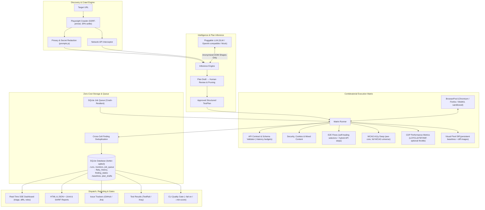

# QualityPilot

> Autonomous software QA agent for web applications and APIs — crawls, infers test plans (with human approval), executes matrix test suites across browsers, viewports, and authenticated roles, files deduplicated regressions to your issue tracker, and gates your CI pipeline.

QualityPilot is a zero-cost, self-hostable QA testing platform built on Node.js and Playwright. Give it any target web URL and QualityPilot will autonomously crawl pages, inspect network waterfalls with automatic privacy redaction, generate test suites via an AI planner (or deterministic heuristics), and run combinatorial tests across browsers, responsive viewports, and authenticated sessions. All runs, monitors, job queues, flaky history, visual baselines, and finding triage state are persisted locally in SQLite with zero cloud dependencies.

---

## ⚡ 2-Minute Quickstart

### Prerequisites
- Node.js >= 20.0.0
- npm >= 9.0.0

### 1. Install

**From npm (recommended):**

```bash
npm install -g qualitypilot
npx playwright install chromium   # one-time browser download (~130 MB)
```

This installs the `qualitypilot` CLI and `qualitypilot-mcp` MCP server.

**From source (development):**

```bash
git clone https://github.com/saqi-saqi/QualityPilot.git
cd QualityPilot
npm install
npx playwright install --with-deps chromium
```

This gives you the same commands locally through the repository scripts:
`npm run check -- <url> …` (CI gate CLI) and `npm run mcp` (MCP server).

### First scan (CLI, no dashboard needed)

```bash
qualitypilot check https://example.com --max-pages 3
```

Prints a score and a findings summary, and exits 0 when the quality gate
passes (exit 1 = gate failed, 64 = usage error, 70 = scan failure). To scan a
local dev server, set `SQA_ALLOW_PRIVATE=true` in the environment.

### 2. Start the Server & Dashboard
```bash
npm run start:dashboard
```
Open **[http://localhost:8080](http://localhost:8080)** in your browser.

> **Security defaults**: the dashboard binds to `127.0.0.1` only (override with `SQA_BIND`), ships with helmet security headers and API rate limiting, and **refuses to start without an API token when `NODE_ENV=production`**.

### 3. Run Your First Scan
Trigger a headless scan against any public site directly from your terminal:
```bash
# Using curl
curl -X POST http://localhost:8080/api/runs \
  -H "Content-Type: application/json" \
  -d '{
    "url": "https://example.com",
    "options": {
      "maxPages": 3,
      "browsers": ["chromium"],
      "concurrency": 2
    }
  }'
```
Or open the dashboard UI at `http://localhost:8080`, type `https://example.com`, and click **Start Test** — or click **🧭 Review plan** first to inspect, prune, and approve the AI-generated test plan before anything runs.

*(To test local dev sites on `localhost`, set `SQA_ALLOW_PRIVATE=true` in `.env`)*

### Use FreeLLMAPI locally

QualityPilot can use a local [FreeLLMAPI](https://github.com/tashfeenahmed/freellmapi)
gateway through its OpenAI-compatible endpoint:

```dotenv
SQA_LLM_PROVIDER=openai
OPENAI_BASE_URL=http://localhost:3001/v1
OPENAI_API_KEY=sk-your-openai-compatible-key
OPENAI_MODEL=auto
```

Keep the key in `.env` or your user-level environment; do not commit it or
place it in VS Code workspace settings. For VS Code coding assistance, install
an OpenAI-compatible extension such as Continue, Cline, or Roo Code and use:

- Base URL: `http://localhost:3001/v1`
- API key: your FreeLLMAPI unified key
- Model: `auto` (or a model shown by FreeLLMAPI's `/v1/models` endpoint)

The built-in GitHub Copilot service cannot be redirected to a custom endpoint;
these extensions are separate clients. Keep FreeLLMAPI bound to localhost and
do not expose port `3001` publicly.

---

## 🤖 Use QualityPilot from Claude Code / Cursor

QualityPilot exposes an official [Model Context Protocol (MCP)](https://modelcontextprotocol.io/) server running over standard input/output (`stdio`). This allows AI coding agents (Claude Code, Cursor, Codex, or any MCP-compatible client) to call QualityPilot's accessibility, API contract, console error, and security checks directly inside their edit-test-fix loop.

### 1. Register the MCP Server

Add this configuration snippet to your `.mcp.json` (Claude Code) or Cursor MCP settings (`~/.cursor/mcp.json` or `.cursor/mcp.json`):

```json
{
  "mcpServers": {
    "qualitypilot": {
      "command": "qualitypilot-mcp",
      "env": {
        "SQA_ALLOW_PRIVATE": "true"
      }
    }
  }
}
```

Running from a source checkout instead of a global install? Use
`"command": "node"` with `"args": ["src/mcp/stdio.js"]` and set the working
directory to the repo root.

> **Why `SQA_ALLOW_PRIVATE=true`?**
> QualityPilot's enterprise SSRF boundary blocks private IP ranges (`127.0.0.1`, `10.0.0.0/8`, `192.168.0.0/16`, CGNAT, cloud metadata endpoints) by default. Setting `SQA_ALLOW_PRIVATE="true"` permits local loopback scanning so your agent can verify `http://localhost:3000` or local dev servers.

> **Security Note**: The `stdio` transport runs as a local subprocess with zero network exposure. If an HTTP/SSE transport is enabled for remote access in the future, token authentication becomes mandatory.

### Zero-config demo (no LLM key required)

QualityPilot runs without any AI credentials: plan inference falls back to
deterministic heuristics (the `mock` provider). One warning line is expected:

```
[llmProvider] No LLM provider configured ... using MockProvider
```

Set `SQA_LLM_PROVIDER=mock` to silence it. To enable AI planning, set
`SQA_LLM_PROVIDER=openai` with `OPENAI_API_KEY` (plus optional `OPENAI_BASE_URL`
for any OpenAI-compatible gateway). The `z-ai-web-dev-sdk` vendor SDK ships as
an **optional dependency** - it is only loaded when you explicitly select
`SQA_LLM_PROVIDER=glm`, so its absence never breaks installation or the other
providers.

### 2. Available MCP Tools

| Tool | Purpose | Latency |
| :--- | :--- | :--- |
| `quick_check(url, scope?)` | Fast check (axe a11y + API contract + console/network errors) on a single page | ~5–15s |
| `check_accessibility(url)` | Focused WCAG a11y audit (axe-core) for markup & styling changes | ~1–3s |
| `check_api_contract(url, endpoints?)` | Probes REST endpoints for unexpected status codes or broken response schemas | ~100ms–2s |
| `explain_finding(rule_id)` | Plain-language explanation + recommended fix for any rule ID (e.g. `image-alt`) | Immediate |
| `start_full_scan(url, options?)` | Asynchronous deep matrix scan (crawls, multi-browser, viewports). Returns `job_id` | Immediate |
| `get_scan_status(job_id)` | Polls status (`pending` | `running` | `complete` | `failed`) and pages scanned | Immediate |
| `get_scan_report(job_id, verbosity?)` | Invariant-validated structured JSON report with CONFIRMED findings | Immediate |

### 3. Example Prompts for Your Coding Agent

Once connected, you can give your AI agent natural prompts like:

- **Pre-commit verification**:
  > *"Run a quick check against http://localhost:3000 before I commit this change."*
- **A11y regression check**:
  > *"I just refactored the checkout modal and form inputs. Run check_accessibility against http://localhost:3000/checkout and fix any violations."*
- **Investigate & repair**:
  > *"The quick check failed on rule `api-status-mismatch`. Call explain_finding to understand the requirement, find the route handler, and fix the mismatch."*
- **Deep matrix scan**:
  > *"Start a full scan on http://localhost:3000 with start_full_scan, poll get_scan_status until done, and summarize confirmed bugs."*

---

## 🐳 Self-Host with Docker (1 Command)

QualityPilot runs on 100% free, official Docker base images with zero external services:

```bash
cp .env.example .env
docker compose up -d --build
```
Your dashboard is live on `http://127.0.0.1:8080` (the compose file publishes the port to loopback only), running as a non-root user, with the SQLite database and screenshots persisted to `./data`.

---

## 🏛 Architecture



### Module Breakdown
- **`src/matrix/`**: Combinatorial execution engine testing $\text{Browsers} \times \text{Viewports} \times \text{Auth Roles}$. Deduplicates findings by `(ruleId, pageUrl, element)` and tracks flaky tests (grouped by normalized options, ≥3 alternations required).
- **`src/storage/`**: Relational persistence via `better-sqlite3` with `PRAGMA user_version` migrations — `runs`, `monitors`, `job_queue`, `flaky_history`, `finding_states`, `baselines`, `plan_drafts` — designed for future zero-friction migration to PostgreSQL.
- **`src/services/jobQueue.js`**: Atomic SQLite-backed job queue. Guarantees in-flight and queued runs survive process crashes and restarts without Redis or BullMQ; interrupted runs are recovered and marked failed on boot, and SIGTERM/SIGINT drain cleanly.
- **`src/explorer/`**: AI test planner. Generates E2E user flows (with self-healing-selector-aware inference and `needsReview` flags for hallucinated selectors) and API schema expectations using anonymized DOM structure. Flags flows for review when selectors were never observed in the crawl.
- **`src/executors/selectorResolver.js`**: Deterministic selector self-healing ladder (original → `data-testid`/`data-test`/`aria-label` → role → text). Heals rotting selectors instead of failing noisily.
- **`src/services/testData.js`**: Test-data store (`data/testdata.json` + `SQA_TD_*` env vars) with `${VAR}` substitution in flow steps — no invented credentials.
- **`src/services/ssrf.js`**: Enterprise SSRF protection. Blocks IPv4/IPv6 private subnets, CGNAT, link-local, unique-local, 6to4/NAT64; validates **every** plan URL (flows, navigate steps, API endpoints) before any browser launches, and pins validated IPs via Chromium `--host-resolver-rules` to defeat DNS rebinding.
- **`src/services/sessionStore.js`**: Encrypted "record-once login" store using AES-256-GCM with a per-install random salt. Supports multiple named roles per monitor (e.g. `admin`, `customer`) without saving user credentials in plain text.
- **`src/services/compliance.js`**: Maps axe-core accessibility audit rules to WCAG 2.x A/AA criteria over the **full WCAG-tagged axe rule universe**, marks partial coverage honestly, and exports VPAT-style evidence reports.
- **`src/services/runDiff.js`**: Run-to-run comparison — new / resolved / persistent findings and score delta.
- **`src/reporting/`**: JUnit XML and SARIF 2.1.0 serializers for CI pipelines.
- **`src/cli/check.js`**: CI quality gate — exit codes driven by severity thresholds and minimum score, plus `--junit`/`--sarif` report export.

---

## 🔁 Continuous Monitoring & Triage

- **Monitors** re-scan targets on a schedule with duplicate-trigger protection, catch-up after downtime, and per-monitor settings.
- **Record-once logins** capture a session (2FA/CAPTCHA included — you log in yourself) encrypted at rest; record **multiple roles** per monitor and the matrix replays each role.
- **Finding triage**: mark findings `acknowledged` / `false positive` / `fixed` in the dashboard — state persists across runs.
- **Run diff**: "Compare with previous run" shows exactly what's new, resolved, and persistent, with a score delta.
- **Flaky tracking**: results feed a flaky-history table (grouped by options hash; labeled flaky only after ≥3 alternations).
- **Retention**: old runs and screenshots are cleaned up automatically (checked at boot and every 6 hours).

## 🚦 CI Quality Gates

Fail builds on quality regressions straight from the CLI:

```bash
# Installed package:
qualitypilot check https://staging.example.com \
  --max-pages 10 \
  --fail-on critical,high \
  --min-score 80 \
  --junit test-results.xml \
  --sarif qualitypilot.sarif

# From a source checkout:
npm run check -- https://staging.example.com --max-pages 10 --fail-on critical,high --min-score 80
```
- `--fail-on critical,high` → exit 1 when any **confirmed** finding at those severities exists (single value = threshold semantics).
- `--min-score 80` → exit 1 when the quality score drops below 80.
- JUnit XML and SARIF 2.1.0 output plug into GitHub Actions, GitLab, Azure DevOps, and code-scanning UIs.

### Regression-only gating (`--baseline`)

On a second and every later scan, fail the build only on **new** findings — pre-existing issues stop blocking every PR:

```bash
# First run — the JSON report becomes the baseline (stdout is pure JSON; progress goes to stderr):
qualitypilot check https://staging.example.com --format json > baseline.json

# Every later run — exit 1 only when a NEW finding appears:
qualitypilot check https://staging.example.com --baseline baseline.json --fail-on low
```

- `--baseline <file|runId>` accepts a saved `--format json` report or a stored run id; an unreadable baseline is a usage error (exit 64), never a silent pass.
- `--fail-on` then applies to **new** findings only; `--min-score` stays an absolute check on the current run's score.
- The JSON output gains a `baseline` block (`newFindings`, `resolvedFindings`, `persistentCount`, `scoreDelta`).

### Injection probing (Phase 8)

A dedicated `injection` executor runs three bounded, non-destructive probes and classifies results by **response differentials** (status class, length, and SQL error-signature matching), not by payload presence:

- **GET query-param differential** — mutating a captured query param (e.g. a search `q`) that turns a healthy 200 into a 500 with a SQL error signature (`SQLITE_ERROR`, MySQL/PostgreSQL/Oracle/MSSQL/Sequelize patterns) → `injection-sqli-error`.
- **Login-form auth bypass** — submits login-class forms twice (benign values, then a tautology email) and compares the login XHR status: 401 → 200 is an authentication bypass → `injection-sqli` (high). The mutated response body is never captured (it contains credentials). Account-creation pages are excluded — probes must not create data.
- **Search-route DOM sink** — loads the SPA search route with an executable-markup payload and checks whether the raw payload became LIVE DOM (not escaped text) → `injection-xss-dom`.

Safety model: probes run **by default on loopback targets only** (`localhost`, `127.0.0.0/8`, `::1`). Non-loopback targets require the explicit flag:

```bash
qualitypilot check https://staging.example.com --authorized-target
```

No `DROP`/stacked payloads exist; login sessions created by a probe die with the scan's browser context. On clean apps the probes stay silent (verified: authorized scan of the RealWorld Conduit demo → 0 injection findings).
### Speed (`--concurrency`)

Matrix cells run in parallel — browser cells share one browser process through the pool, no-browser cells (security, API contract, links/console/network) fully parallelize:

```bash
qualitypilot check https://staging.example.com --concurrency 4   # 1–4, default 2
```

Form fuzzing loads each page **once per target** (safe mode never submits, so there is no server traffic to pace) and re-navigates only after a thrown input, instead of re-navigating for every single input.
### Job-summary markdown

`--format markdown` renders a compact gate summary (verdict, severity counts, top rules, new-vs-baseline diff) for `$GITHUB_STEP_SUMMARY`, PR comments, or tickets:

```bash
qualitypilot check https://staging.example.com --baseline baseline.json --format markdown >> "$GITHUB_STEP_SUMMARY"
```

## 🎯 Benchmarked Recall & False-Positive Triage

We hold the scanner to the same bar it holds your app. Two proof artifacts ship in the repo and run on demand:

- **Juice Shop recall harness** (`benchmark/run-recall-benchmark.mjs` + `benchmark/groundtruth-juiceshop.json`): runs the default full-surface `qualitypilot check` pipeline against a local OWASP Juice Shop v20.4.0 and scores it against a deterministic ground truth. Every expectation is **re-verified against the live target before scoring** (target drift cannot fake a number), and known false-positive modes are asserted as must-not-find rules. Recorded Phase F run: **6/6 expectations detected (100% recall), 0 false-positive-guard violations, 16 distinct rules over 9 pages in 644s**. The detailed run receipt is retained locally in the ignored `benchmark/results/` directory.
- **RealWorld/Conduit false-positive triage**: the same pipeline against the official RealWorld Conduit demo, with every finding classified true/false positive against the [documented Conduit API spec](https://github.com/gothinkster/realworld/blob/main/specs/api/openapi.yml) (401/404/409/422 are spec-defined responses, not defects). The detailed classification receipt is retained locally in the ignored `benchmark/results/` directory.

Methodology notes: only deterministic expectations score recall — crawl-state-dependent detectors (axe, console, links) are reported as observational context; the benchmark measures exactly what a user gets from the default executor list, no special benchmark mode.

A product landing page ships in [`landing/`](landing/index.html) — a single static file, deployable anywhere.

---
## GitHub Action

QualityPilot can replay an exported test plan against a preview deployment and fail the workflow when the configured quality gate is not met.

```yaml
name: QualityPilot QA

on:
  pull_request:

jobs:
  quality:
    runs-on: ubuntu-latest
    steps:
      - uses: actions/checkout@v4

      - name: Replay QualityPilot plan
        uses: saqi-saqi/QualityPilot@v0.3.0
        with:
          plan: qualitypilot/plan.json
          url: ${{ secrets.PREVIEW_URL }}
          fail_on: critical,high
          min_score: 80
```

The action runs the exported plan without an LLM key, writes a summary to the GitHub Actions job summary, and returns a failing exit code when the quality gate is violated. Export a plan with:

```bash
qualitypilot export plan.json --format plan --out qualitypilot
```

Use a release tag such as `v0.3.0` in production workflows so upgrades are deliberate.

---
## 📦 Export Your Tests

One plan, two destinations:

```bash
qualitypilot export plan.json --format both --out ./export
```

- **`plan.json`** — the portable plan artifact. Feed it to CI plan replay:
  inferred once, replayed forever without an AI key. The plan is
  schema-validated and normalized on export — what you export is exactly
  what replays.
- **`<flow>.spec.ts` + `qualitypilot-healer.ts`** — standalone Playwright
  specs. Interaction steps (click/fill/select/check/…) route through the
  self-healing selector ladder; `${VAR}` test-data placeholders resolve from
  the environment at runtime. Multi-role: pass
  `--storage-state user=states/user.json` to wrap flows in per-role
  `test.describe` blocks with `test.use({ storageState })`.

Scope: flows only — perf budgets, a11y rules, fuzz targets and visual
baselines stay QualityPilot-native (they need the runtime).

## 📋 Publish Results Where QA Lives

- **TestRail**: `SQA_TESTRAIL_*` env vars + `data/testrail-map.json` (`{"ruleId::pageUrl": caseId}`) → creates a run and posts pass/fail per case. Unmapped findings are listed, never auto-created.
- **Xray (Jira)**: `SQA_XRAY_*` env vars + `data/xray-map.json` (`{"signature": "TEST-123"}`) → imports an execution with PASS/FAILED per test key.
- Or trigger both from the run page in the dashboard.

## ♿ Accessibility Compliance Evidence

The run page exports a **WCAG evidence report** (JSON): per-criterion pass/fail/not-tested status mapped over the full WCAG-tagged axe rule universe, with failing node selectors, tool versions, and a generation timestamp — the starting point for a VPAT/ACR. Conformance percentages are computed over the full universe and marked `partial` when the plan executed a subset.

---

## 🧭 Open Source Core vs. Hosted Cloud Seams

QualityPilot is developed as an open-core architecture. Everything needed to test, crawl, plan, and monitor your web applications is 100% free and open source.

| Capability | Open-Source Engine (This Repo) | Future Hosted Cloud Tier |
| :--- | :---: | :---: |
| **Execution Engine** | Complete (All 7 executors + Matrix runner) | Cloud-managed browser grid |
| **Persistence** | Embedded SQLite (`better-sqlite3`) | Multi-tenant PostgreSQL (Supabase / RDS) |
| **Job Queue** | SQLite persistent queue (`job_queue` table) | Distributed worker cluster |
| **Issue Filing** | GitHub, Jira, Console | GitHub, Jira, GitLab, Linear, Asana |
| **Test Management** | TestRail, Xray (mapping files) | Native suite sync |
| **Dashboard** | Lightweight local SSE dashboard (triage + diffs) | Multi-tenant team workspace |
| **Visual Testing** | Persistent baselines + diff images (SQLite-backed) | Baseline approval workflow UI |
| **Authentication** | Local AES-256 multi-role session vault | Enterprise SAML / Okta SSO |

> **Architectural Seam Note**: The database schema in `src/storage/db.js` uses standard ANSI SQL (`TEXT`, `REAL`, `INTEGER`, JSON columns) and avoids SQLite-specific quirks. When enabling the hosted tier, swapping the SQLite driver for a PostgreSQL pool requires zero changes to the core business logic.

---

## 🔒 Security & Privacy Guarantees

1. **AI Anonymization**: Session cookies, Bearer tokens, and user passwords **never touch the LLM**. Request bodies are filtered and only structural shapes (e.g. `{"id": "string"}`) are sent to inference models; page content is wrapped in untrusted-data delimiters with prompt-injection guards. Enforced in `src/explorer/prompts.js` and verified by `test/llmPrivacy.test.js`.
2. **Encrypted at Rest**: Recorded authenticated sessions are encrypted using **AES-256-GCM** with a per-install random salt and a persistent local key (`data/.session.key`) or your custom `SQA_SESSION_SECRET`.
3. **SSRF Hardened**: Crawls, HTTP probes, and **every URL inside a test plan** (flow start URLs, navigate steps, API endpoints) are validated against public IP ranges — including CGNAT and 6to4/NAT64 ranges — and validated DNS answers are pinned into the browser to defeat DNS-rebinding. `file:`/`data:`/`ftp:` URLs are rejected outright.
4. **Hardened by default**: sandboxed Chromium (no `--no-sandbox` unless you explicitly opt in), non-root Docker user, loopback-only bind, helmet headers, per-IP rate limiting, timing-safe token comparison, constant-coverage auto-close in the issue tracker (partial scans never close bugs), and cross-origin API probes blocked.
5. **Secret hygiene**: recorded session capture is only accepted from the monitored origin, `Secure` cookies are never replayed over plain HTTP, and the MCP layer re-redacts keys/tokens (including `ghp_`, `sk-`, `xox`, AWS, and generic secret-shaped values) before anything leaves the process.

---

## 🩺 Troubleshooting

| Symptom | Fix |
| :--- | :--- |
| `Executable doesn't exist ... npx playwright install` | Browsers download separately from the npm package: run `npx playwright install chromium` (Firefox/WebKit are only needed for multi-browser matrix scans) |
| `better-sqlite3` build errors during install | Prebuilt binaries cover Node 20/22/24 on Windows/macOS/Linux (x64 + arm64). If your platform has no prebuild, install build tools (Windows: VS Build Tools "Desktop development with C++"; macOS: Xcode CLT; Linux: `build-essential` + `python3`) and reinstall |
| Scanning `http://localhost:...` is blocked | Set `SQA_ALLOW_PRIVATE=true` (CLI env or the MCP server `env` block) - the SSRF guard blocks private ranges by default |
| `[llmProvider] No LLM provider configured ... using MockProvider` | Informational, not an error: deterministic heuristics replace AI planning. See *Zero-config demo* above |
| `ERROR: Usage: ...` and exit code 64 | CLI arguments were invalid - check the options list via `qualitypilot` with no arguments |

## 🧪 Testing

QualityPilot has a comprehensive unit and integration test suite:

```bash
npm test
```
All **~950 tests** run via Node.js native test runner in ~25 seconds with zero external dependencies (the runner works on every supported Node version, 20+).

---

## 📜 License

Licensed under the **[Apache License, Version 2.0](LICENSE)**.
You may freely use, modify, distribute, and self-host QualityPilot for personal or commercial projects.
